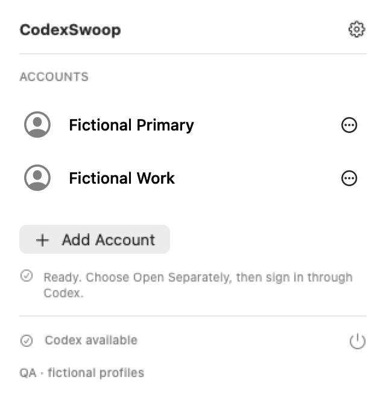
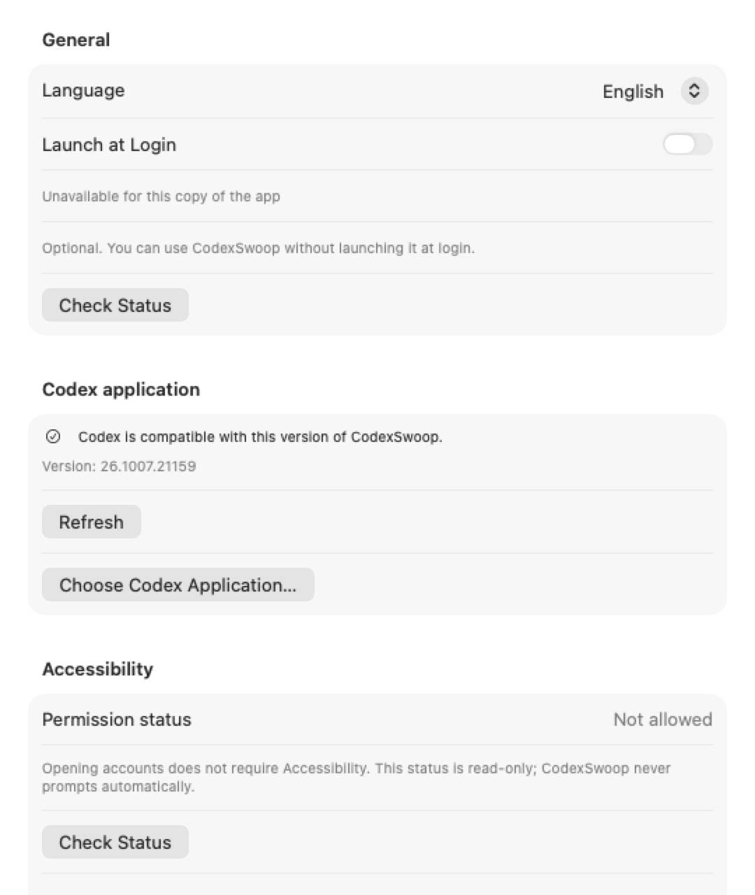
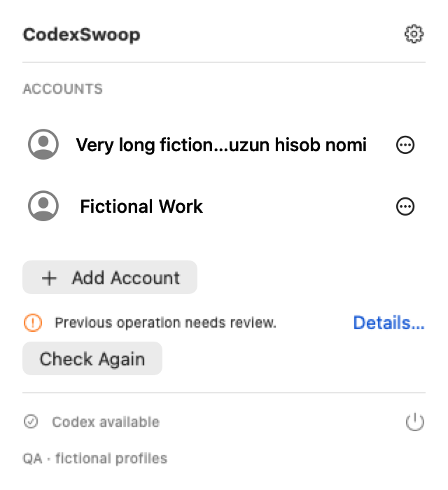

  

<h1 align="center">CodexSwoop</h1>

<strong>Multiple local Codex profiles. One Mac.</strong>

A native macOS menu bar app for organizing local profiles and their Codex environments.

1.0.0-rc.2 · Experimental Pre-release · Apple Silicon arm64 · MIT License

  

<em>Product overview · Off-screen render with fictional profiles and state.</em>

## Why CodexSwoop?

Keep local Codex environments organized under profile names you choose. CodexSwoop points to environments used by the official Codex app; sign-in stays in Codex.

A profile name is only a local label and does not verify which ChatGPT account is signed in. Adding, renaming and removing profiles does not require a particular Codex version or a verified Codex installation. Metadata integrity and pending-recovery safeguards still apply.

## Features

- Link the standard Codex environment or prepare a separate Managed environment.
- Open a linked environment separately when its publisher, installation and ownership checks allow it.
- Use **Close Others & Open** with confirmation when running instances can be identified safely.
- Rename or remove local profile records without deleting underlying Codex authorization directories.
- Review Codex detection and Accessibility status, change the app language, and configure Launch at Login in Settings.

## Screenshots

These are off-screen renders of the app's real views using synthetic project fixtures, not recordings of signed-in user accounts.

  

<em>Settings · Synthetic UI fixture.</em>

## How It Works

CodexSwoop stores local profile and environment-reference metadata. The official Codex app remains responsible for authentication.

- **Standard External** links to the standard Codex environment already on the Mac. Linking does not copy or inspect sign-in credentials.
- **Managed** prepares separate local Codex environment directories. Sign in through the official Codex app after opening one.
- Separate directories do not guarantee complete authentication isolation; shared macOS services, browser sign-in, and Codex behavior can affect environments.

## Installation

The next GitHub Pre-release candidate is **1.0.0 (build 5)**. RC 2 publication is pending approval. See the [RC 2 Release Notes](docs/RELEASE_NOTES_v1.0.0-rc.2.md); the candidate fixes ordinary official Codex updates blocking core functions. Its DMG is explicitly labeled **unnotarized**, is **ad hoc signed**, contains an **ad hoc-signed** app, and has no Developer ID signature. macOS Gatekeeper may block first launch. See the [Release Notes and installation instructions](docs/RELEASE_NOTES_v1.0.0-rc.2.md) before installing. This is an experimental candidate, not a fully validated stable release.

## Getting Started

With a verified official Codex installation, follow [Getting Started](docs/GETTING_STARTED.md) to link an existing environment or prepare a Managed one.

## Privacy & Safety

CodexSwoop does not import tokens or cookies into its profile metadata. Removing a profile removes its CodexSwoop record and active link; it does not delete underlying Codex authorization directories or close a running Codex instance. A removed Managed environment may remain available to restore in Settings.

Instance ownership checks are conservative. An unknown instance may block an operation or require review. Closing several instances is not atomic, and an uncertain result can need manual review. **Check Again** rechecks current processes and environment ownership without launching or closing Codex.

See [Security](docs/SECURITY.md) for the project's security boundaries.

  

<em>Recovery review · Synthetic operation-review fixture.</em>

## Compatibility & Limitations

- **Apple Silicon arm64 only** (M1 or newer); Intel is not supported. Deployment target: **macOS 14.0**. Sonoma runtime acceptance has **not** been performed.
- Automated candidate checks run on **macOS 27.0.1 (26A434)**. This does not establish final installer/first-launch acceptance or compatibility on other macOS versions. VM and clean-machine tests are not performed for this Pre-release.
- Official Codex at **`/Applications/ChatGPT.app`** is verified by Bundle ID, the OpenAI signing requirement and Team ID, executable, canonical path and current installation/process evidence. Ordinary version/build changes do not block core functions. **26.1007.21159 (20052)** remains the last individually tested version; newer versions are shown as informationally untested. Detection alone does not establish trust.
- ChatGPT account identity is **not technically verified**. Full authentication isolation is **not guaranteed**. Verify the signed-in account yourself inside Codex.
- **Live Usage is disabled**. Live Usage and technical identity verification are deferred to 1.1.
- The first DMG uses an **ad hoc app signature**, has **no Developer ID**, and is **not notarized**. Gatekeeper acceptance is not claimed.

## Documentation

- [User Guide](docs/USER_GUIDE.md) · profile actions and their limits
- [Troubleshooting](docs/TROUBLESHOOTING.md) · common issues and recovery steps
- [Security](docs/SECURITY.md) · security boundaries

Report bugs through [GitHub Issues](https://github.com/cbrwvy/codexswoop/issues), including version/build, macOS version, Apple Silicon model, supported Codex version, action, expected result, and actual result. Issues and pull requests are welcome. Use fictional profiles in reproduction steps and remove personal information from diagnostics. Never attach credentials, cookies, authorization files, or private account data.

## Building from Source

See [BUILDING.md](docs/BUILDING.md) for build and development instructions. No account credentials are needed to compile the project.

## License & Disclaimer

CodexSwoop is distributed under the [MIT License](LICENSE). It is an independent project, not affiliated with, endorsed by, sponsored by, or officially supported by OpenAI.
